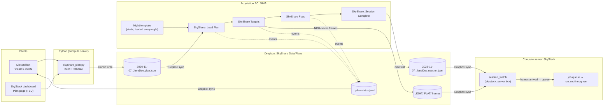
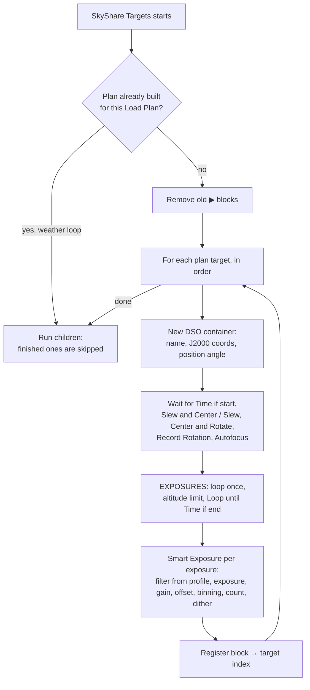
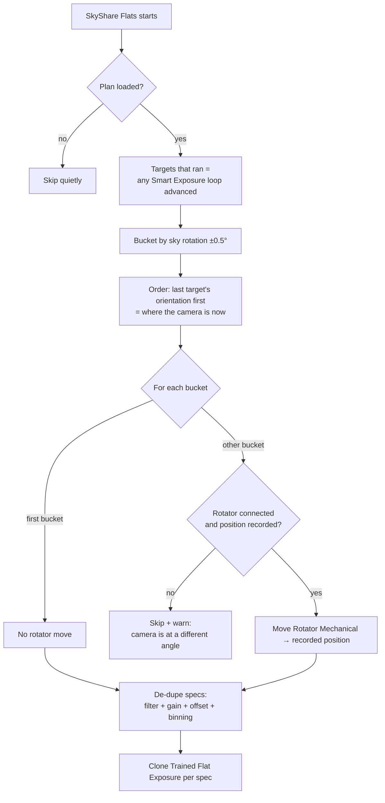
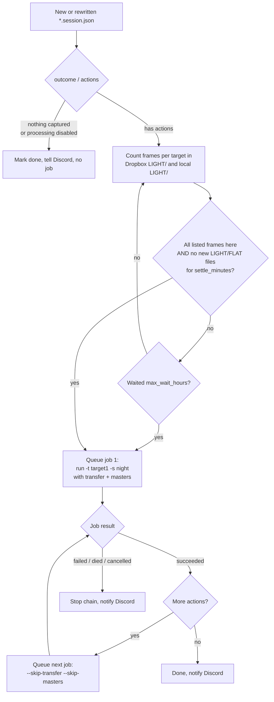

# SkyShare Planner

**SkyShare Planner** builds the night's NINA sequence from a plan file:

1. The Discord bot or the SkyStack dashboard writes a small **plan file** describing one reserved night (targets, order, time windows and exposures) into Dropbox.
2. A NINA plugin reads that plan when the sequence starts and builds the real sequence from NINA's own instruction objects.

This replaces `NINASequenceGenerator.py`, which edited `TemplateSequence.json` as text. Compared with that approach, the plugin:

* handles multiple targets per night, in a fixed order that you control (no scheduler picking targets),
* builds flats after imaging, only for the targets that actually ran, de-duplicated and grouped by camera orientation,
* matches the plan's filters to the live NINA profile (by meaning, so `H` finds a filter called `Ha 7nm`; see *Filter names* below) and refuses a plan for the wrong night,
* handles `$id`/`$ref` itself, because NINA does the saving and loading, so there is no renumbering,
* reports progress back to Discord,
* hands the night to SkyStack when it ends: a **session manifest** tells the compute server what was captured and what to run, and SkyStack starts the pipeline once the files have arrived ([§6](#6-hand-off-to-skystack)).

> **Status: scaffold.** The Python side and the plugin's logic layer (`SkyShare.Planner.Core`) have tests. The NINA-facing layer has **not been compiled yet**. It was written against the NINA 3.x sequencer API, and calls that need checking against the NINA source are marked `// VERIFY`. See [First build checklist](#first-build-checklist).

---

## 1. Pipeline overview



* **Only the plan file travels.** The NINA template stays the same every night. Everything that varies between nights is in the plan, and everything about how the scope runs is in the template.
* **Dropbox is the transport.** You already sync it, so there are no ports to open and nothing breaks if Tailscale is down. Status comes back the same way, and optionally via a Discord webhook.
* **The night ends with a hand-off.** *Session Complete* writes a manifest. SkyStack waits for the frames it lists, then runs the pipeline jobs it names.
* **Validation happens twice.** Python checks the plan when it's written, so a typo is caught while the user is still in the chat. The plugin checks again at dusk against the real profile and equipment.

---

## 2. What happens during the night


**When blocks appear:** target blocks are generated as soon as *Load Plan* succeeds, so tonight's targets are visible in the sequencer from the Start area onwards. (If *Load Plan* can't find a *SkyShare Targets* container, the container builds itself when it runs.) *Load Plan* also fills *SkyShare Flats* with a **preview** that assumes every target runs. Rotator moves to other orientations show as *"set after imaging"* and are disabled, because the rotator position is only recorded while imaging. When *SkyShare Flats* runs, it replaces the preview with the real flats: only targets that got frames, with the recorded rotator positions.

**Problems show up in NINA.** Warnings (skipped flats, plan warnings) and errors (missing or invalid plan, a block that couldn't be built, a manifest that couldn't be written) go to NINA's log at that level and pop up as a NINA notification. They are also written to the status file with `"level": "warning"` or `"error"`.

**Weather loops:** if "When Safe" loops after an unsafe interruption, `SkyShare Targets` does **not** rebuild. Finished targets keep their *finished* status, so NINA resumes at the interrupted target.

---

## 3. Template contract

The plugin **generates** each target block and each flats block itself, from the plan. You don't build or maintain anything inside *SkyShare Targets* or *SkyShare Flats*; leave them empty.

Everything about how *your* observatory runs stays in the template, in the containers around them: startup, safety, meridian flip, guiding recovery, autofocus triggers, Discord alerts, panel and park steps. Triggers on *When Safe* (meridian flip, AF after HFR increase, Restore Guiding, …) apply to the generated targets as usual.

```text
Night template (saved once; replaces TemplateSequence.json)
│
├─ Start
│   ├─ SkyShare: Load Plan            ← NEW, first instruction (Error behaviour: Abort)
│   │                                    (settings: Options > Plugins > SkyShare Planner)
│   └─ STARTUP …                       (unchanged: cool camera, unpark, …)
│
├─ Targets
│   └─ IMAGING INSTRUCTIONS
│       └─ SkyShareAstro Session       ← NEW, holds the body of the night (see below)
│           ├─ When Safe               (unchanged: safety condition + your triggers)
│           │   └─ SkyShare Targets    ← NEW, replaces "TEMPLATE DSO"; leave empty
│           │       ├─ ▶ NGC 7635      (generated at run time, see below)
│           │       └─ ▶ M 31
│           └─ When Unsafe …
│
└─ End
    └─ END OF SEQUENCE
        ├─ (your cover / park steps)
        ├─ SkyShare Darks              ← NEW, optional; leave empty. Does nothing unless the plan has darks
        │   ├─ ▶ DARKS (fixed)
        │   └─ ▶ DARKS (until astronomical dawn)
        ├─ FLATS                       (unchanged: panel, wait for sunrise, alert …)
        │   └─ SkyShare Flats          ← NEW, replaces "FLAT INSTRUCTIONS"; leave empty
        │       ├─ ▶ Flats @ 35° - M 31       (generated: current orientation first)
        │       └─ ▶ Flats @ 0° - NGC 7635    (generated, only if a rotator exists)
        ├─ END …
        └─ SkyShare: Session Complete  ← NEW, very last item: writes the manifest for SkyStack
```

Each generated target block looks like this:

```text
▶ M 31  (Deep Sky Object container: name, J2000 coords, position angle)
│  trigger: Center After Drift     ← every target; "Center drift threshold" (default 5′)
├─ Wait for Time                   ← only if the plan has "start"
├─ Slew, Center and Rotate         (Slew and Center if no rotator in the profile)
├─ SkyShare: Record Rotation       (no-op without a rotator)
├─ Run Autofocus                   ← if "Autofocus at start" is ticked
└─ EXPOSURES
    ├─ cond: Loop 1×               ← by-filter mode only: run the exposure list once
    ├─ cond: Altitude below N°     ← "stop below" setting (default 20°)
    ├─ cond: Loop until Time       ← only if the plan has "end"
    ├─ cond: SkyShare: Target Limits ← only if the plan has max_frames / max_hours / next_target_altitude
    ├─ Smart Exposure per plan exposure
    └─ Dither                      ← cycle mode only: once per cycle
```

**Two ways to shoot a target** (plan field `cycle`):

| | By filter (`"cycle": false`, default) | Cycle (`"cycle": true`) |
|---|---|---|
| `exposures[].count` | total frames for that filter | frames of that filter **per cycle** |
| Order | all L, then all R, … | L L L R G B, dither, L L L R G B, dither, … |
| Dithering | every N frames (*Dither every* on Load Plan) | always once at the end of each cycle (Smart Exposures dither after 0; *Dither every* is ignored) |
| Ends when | the list is done, or a limit is hit | a limit is hit |

For LRGB at 3 L per R, G and B, use `"cycle": true` with counts L 3, R 1, G 1, B 1. NINA applies your profile's filter focus offsets on every filter change, so cycling doesn't need a refocus each time.

**Limits** (any target, either mode; whichever comes first stops the target):

| Plan field | Stops the target when… |
|---|---|
| `end` | the clock reaches this local time (HH:MM) |
| `max_frames` | this many light frames have been saved for it |
| `max_hours` | this many hours have passed since its first exposure (wall clock, includes weather pauses) |
| `next_target_altitude` | the **next** target in the plan is above this altitude. If it's already above it when this target starts, this target stops right away. Not allowed on the last target. |
| altitude limit | the target itself drops below *stop below* on Load Plan |

Limits are checked between frames, so a target can finish the frame in progress before stopping. Frame counts come from the frames NINA actually saves, and the session manifest uses the same counts. A cycle-mode target with no limits keeps imaging until it sets or dawn, and later targets may never start. Load Plan warns about that.

And each flats block:

```text
▶ Flats @ 35° - M 31
├─ Move Rotator Mechanical         ← only if a rotator position was recorded
└─ Trained Flat Exposure per filter / gain / binning (flats.count frames, panel kept closed)
```

| Plan field | Written to |
|---|---|
| `name`, `ra`, `dec` | DSO container `Target.TargetName`, `Target.InputCoordinates` (J2000). Center and the altitude condition take them from the container. |
| `rotation` | `Target.PositionAngle`, used by *Slew, Center and Rotate*. Every target runs it, so a target still gets rotated if an earlier one was clouded out; NINA only moves the rotator when the solved angle is outside *Options → Plate Solving → Rotation tolerance* (about 1° keeps calibration consistent). A one-rotation night's flats need no rotator move. |
| `start` / `end` | *Wait for Time* / *Loop until Time* (plain clock time). Left out if `null`. |
| `exposures[]` | one Smart Exposure per entry: `SwitchFilter.Filter`, `TakeExposure.ExposureTime / Gain / Offset / Binning`, `LoopCondition.Iterations` |
| `flats.count` | `LoopCondition.Iterations` inside each Trained Flat Exposure |
| `darks` | see *Darks* below |

Target settings are on the plugin's options page (see *Plugin options* below):

| Setting | Default | Effect |
|---|---|---|
| Stop below … ° altitude | 20 | Altitude condition on each target's `EXPOSURES` |
| Autofocus at start | on | *Run Autofocus* after centering each target |
| Dither every … frames | 1 | Fixed-count (by-filter) targets only: `AfterExposures` on each Smart Exposure's dither trigger (0 = never). Cycle targets always get dither after 0 on their Smart Exposures, and a Dither instruction at the end of the cycle dithers on every iteration. |
| Center drift threshold … arcmin | 5 | *Center After Drift* trigger on every target's container: after a frame, if the plate-solved position is more than this far from the target, NINA re-centers before continuing. |

**Filter names.** Plans store a standard name (`H`, `O`, `S`, `L`, `R`, `G`, `B`). *Load Plan* maps each one to the active profile's own name: exact name, then the same name ignoring case/spaces/dashes and a bandwidth suffix (`Ha 7nm`), then any known alias of the same filter (Ha, H-alpha, OIII, O3, SII, Lum, Luminance, Clear, Red, …). The mapping is posted as a `filters_mapped` status event. Extra spellings go in `<plans folder>\filter_aliases.json` (`{"aliases": {"H": ["My Ha"]}}`), which the Discord bot writes and also reads. Code: `SkyShare.Planner.Core/FilterResolver.cs` and the bot's `filter_names.py` (same table and rules).

Generated blocks start with `▶ `. Every run deletes and rebuilds them, so the saved template never accumulates old targets.

### Night preview

When *Load Plan* succeeds it also simulates the night on a clear sky and posts the result: when imaging starts, when each target runs, how many frames and how much exposure time it gets, and why it stops. It's posted with an altitude chart showing every target on one plot: **solid** while the target is being imaged, **dotted** when it isn't, vertical lines where the sequence changes target, twilight shading, the *stop below* altitude, and the Moon (pale dash-dot curve, labelled with its illumination). The Scheduler Preview chart below shows the Moon too.

* **Same rules as the sequence.** Targets run in plan order from astronomical dusk (or from now, if the plan is loaded later). The simulation uses each target's `start`/`end`, *stop below* altitude, `max_frames`, `max_hours`, `next_target_altitude`, cycle mode and dawn, all checked between frames. A target that is already below the altitude limit when its turn comes is **skipped**, just as the real altitude condition skips it, and the preview warns about it (`target_not_reached`), so a missing `start` time shows up before the night begins.
* **Overheads** come from the *Night preview* section of the plugin options: slew/center/rotate per target (3 min), autofocus (4 min, at target start if enabled and then every 60 min), dither + settle (30 s), per-frame download (5 s) and meridian flip (5 min). They only affect the estimate. Set them to match your template's triggers.
* **Where it goes:** a `night_estimate` status event (with the per-target times as data), `<plan>.night.png` next to the plan in Dropbox, and Discord with the chart attached (Discord Alert's webhook, or `SKYSHARE_DISCORD_WEBHOOK`). The bot can post the same thing with `StatusTailer.image_for(ev)` (see `bot_integration.py`). Use one of the two, or the chart is posted twice.
* **Moon:** each target's line gives how close the Moon gets while it is imaged (only while the Moon is up) and how lit it is, for example "Moon 25° away, 80% lit (close)". *Close* means over half lit and within 40°. "Moon down" means it stays below the horizon.
* **Framing preview** (*with framing*, on by default): a second image in the same Discord message, with one sky-survey cutout per target (up to 9). Each shows the camera's frame at the planned rotation, north up and east left, so you can see what the frame should contain. The frame size comes from the profile's focal length and pixel size, and the sensor size from the camera (or the framing assistant settings if it isn't connected). Images come from CDS (colour DSS2), falling back to its mirror and then NASA SkyView (DSS2 red). Only target coordinates are sent, and cutouts are cached in `%LOCALAPPDATA%\SkyShare Planner\survey-cache`.
* Precision: J2000 coordinates and a low-precision sun and Moon, good to a few minutes and a fraction of a degree. Code: `SkyShare.Planner.Core/NightEstimator.cs` (simulation, unit-tested), `NightSummary.cs` (text), `Runtime/NightChart.cs` (PNG), `Core/Framing.cs` + `Runtime/FramingPreview.cs` (framing).

### Scheduler Preview (Target Scheduler nights)

*SkyShare: Scheduler Preview* is a separate instruction for sequences run by the Target Scheduler plugin. Put it **before** the Target Scheduler container, not inside it. It runs TS's own plan preview (the same as TS's *Plan Preview* panel) for tonight from the current time, and posts the result to Discord with the same style of altitude chart:

* **Chart:** every target TS would image tonight, solid while imaged and dotted otherwise. A target TS comes back to gets one solid stretch per visit. Vertical lines mark each target change, and the *stop below* line is drawn when all projects share the same minimum altitude. Each legend row has a completion bar: how much of the target was done before tonight (solid), plus what tonight adds (faded).
* **Message:** each target's time windows, frames per filter, exposure time and *done% → after tonight%*. Then the order of visits when TS returns to a target, and each project's completion with a text bar, including its targets that aren't scheduled tonight.
* **Caveat:** TS's preview is a "perfect" plan. Slews, autofocus, dithers and flips take no time, and every frame counts as accepted. A real clear night gets somewhat less done, and the message says so.
* **Where it goes:** Discord (same webhook as above) and a `ts_preview` entry in the NINA log. If you set a folder on the instruction, the chart is also saved there as `<night>_target-scheduler.night.png`.
* **Moon and framing:** each target's line includes the Moon at its closest over all of that target's visits. The *Framing preview* option attaches the same framing grid as above, using each TS target's rotation.
* It reads the TS database but never writes to it: the preview works on in-memory copies. TS is found at run time, so SkyShare still works without it; the instruction then just warns. Code: `Runtime/TargetSchedulerBridge.cs` (TS calls), `Core/SchedulerSummary.cs` (blocks, text, chart model; unit-tested).

### Health Check

*SkyShare: Health Check* runs a list of checks and posts them to Discord as one message, problems first, each line marked OK, WARN or FAIL. Put it after connecting equipment and cooling the camera, before the first target.

| Check | FAIL when | WARN when |
|---|---|---|
| Camera, mount, guider, focuser, filter wheel, rotator | the profile uses it but it isn't connected | |
| Camera cooling | | cooler off, or more than 1.5 °C from the set point |
| Disk space (image folder's drive) | less free than tonight needs (estimated frames from the loaded plan + 25% for calibration) | less than that plus *Spare disk space* (default 20 GB) |
| Location | latitude/longitude not set in the profile | |
| Dropbox (optional) | | not running |
| Discord | the webhook URL is rejected (deleted or wrong) | no webhook set, or Discord can't be reached |
| Clock (against `time.windows.com`) | more than 30 s off | more than 2 s off, or no time server reachable |

Two more checks, both WARN only (a Target Scheduler night has no plan): the plans folder exists, and tonight's plan has synced.

*Spare disk space* and the Dropbox check are set on the plugin options page; the same checks can be run from there at any time. By default the instruction only reports. With *Stop on failure* (on the instruction) it fails when any check is FAIL, so the sequence's error behaviour decides what happens next. Code: `Runtime/HealthChecker.cs` (checks), `Core/HealthReport.cs` (levels and text; unit-tested).

### Set Temperature

*SkyShare: Set Temperature* turns the camera cooler on and brings the sensor to a set point. The set point is the plan's optional `camera_temperature` (°C) when it has one, otherwise the instruction's *Fallback*, **0 °C by default**. The instruction shows the loaded plan's temperature and whether it is used. Untick *Use the plan's temperature* to always use the fallback. *Load Plan* warns when a plan's `camera_temperature` and `darks.temperature` differ, since the darks then won't match the lights. *Min Duration* makes the cool-down take at least that many minutes (0 = straight to the set point). The result goes to the NINA log and status file; if the set point isn't reached, it is a warning (also posted to Discord) and the sequence continues. Before the sequence starts, the instruction flags a camera that isn't connected or can't set its temperature. Put it in **Start**, before Health Check, so the cooling check there sees the cooled camera.

### Plugin options

Settings that stay the same from one sequence to the next are on NINA's **Options > Plugins > SkyShare Planner** page, not on the instructions. They are saved in the active NINA profile (a second rig profile can have its own values), and instructions read them when they run, so a change needs no sequence edit.

| Section | Settings |
|---|---|
| Health check | *Run checks* / *Run and post to Discord* buttons with the results; spare disk space; check Dropbox |
| Plans | plans folder; hour the night rolls over (12); wait for the plan to sync (10 min) |
| Targets | stop below altitude; autofocus at start; dither every N frames; re-center drift threshold |
| Night preview | post the preview; with framing; the estimate overheads |
| Calibration nights | switch port powering the flat panel; connect flat panel before calibration; disconnect flat panel once closed |

Only choices that depend on the sequence stay on an instruction: *Stop on failure* on Health Check, and the save folder and framing option on Scheduler Preview.

**Updates.** The page shows the running version and a *Restart N.I.N.A.* button. When a newer version is installed while NINA is running (see *Setup*), NINA shows a notification and the page shows an *Update ready* banner; restarting from there loads it. The button refuses while a sequence is running. The page also checks GitHub for a newer release about a minute after NINA starts and every 12 hours (*Check for updates*, on by default; the only request is an anonymous call to the GitHub API). When there is one, NINA shows a notification and the page shows *Update available* with *Install update*, which downloads that release's installer and runs it silently, so it is staged for the restart. Nothing is installed without that click.

### Darks

A plan can carry a `darks` section. **SkyShare Darks** builds it at Load Plan, like the targets:

```text
SkyShare Darks
├─ ▶ Cool Camera to -10 °C               ← only if darks.temperature
├─ ▶ DARKS (fixed)                        cond: Loop 1×
│   ├─ Take Many Exposures  300s ×20 (DARK)
│   └─ Take Many Exposures  60s ×30
└─ ▶ DARKS (until astronomical dawn)      cond: Loop until Time (Dawn)
    ├─ Take Many Exposures  600s ×1 per round
    └─ Take Many Exposures  120s ×2 per round
```

```json
"darks": {
  "order": "fixed_first",
  "until": "astronomical_dawn",
  "temperature": -10,
  "sets": [
    { "exposure": 300, "count": 20, "gain": 100 },
    { "exposure": 600, "count": 1,  "gain": 100, "repeat": true },
    { "exposure": 60,  "count": 30, "gain": 0 },
    { "exposure": 120, "count": 2,  "gain": 0,   "repeat": true }
  ]
}
```

| Field | Default | Meaning |
|---|---|---|
| `sets[].repeat` | `false` | `false`: a **fixed** set, exactly `count` frames. `true`: a **repeating** set, `count` frames per round. |
| `order` | `fixed_first` | `fixed_first`: all fixed sets, then rounds of the repeating sets until `until`. `repeat_first`: rounds first, then the fixed sets (they're taken after `until`). |
| `until` | `astronomical_dawn` | When the rounds stop: `astronomical_dawn`, `nautical_dawn`, `civil_dawn`, `sunrise`, or a local `HH:MM`. Checked between frames. |
| `temperature` | `null` | Cool the camera to this set point first. `null` leaves the cooler as STARTUP set it. |
| `exposure`, `gain`, `offset`, `binning` | | As for lights. Darks don't change filter. |

In the example, the plugin takes 20 × 300 s and 30 × 60 s first. It then alternates 1 × 600 s and 2 × 120 s until astronomical dawn. If dawn is reached during the fixed sets, the rounds are skipped.

* **Calibration-only nights:** a plan with `"targets": []` and a `darks` section is valid. Put *When Safe* and *When Unsafe* inside a **SkyShareAstro Session** container. On an imaging night it runs them as they are. On a calibration night (no targets), *Load Plan* takes them out of the session container and puts the plan's darks there instead (shown as `▶` blocks), so no safety or dawn wait holds the darks up; any *SkyShare Darks* container elsewhere then skips, so darks are taken once. Loading an imaging plan later in the same NINA session puts *When Safe* and *When Unsafe* back.
  * The darks run where the session container sits, before the *End* steps. Before them the session container covers the scope with the flat panel, which is normally off and disconnected at that point. Set this up in the plugin options under *Calibration nights*: the switch port that powers the panel (pick it from the connected switch's ports, or leave empty if the panel is always powered), *Connect flat panel before calibration* (power the port on, connect the panel in NINA with retries for 90 s while it starts, close the cover) and *Disconnect flat panel once closed*. If the cover can't be confirmed closed, the darks don't run: the session container fails with `calibration_cover_failed`. A panel without a motorised cover only gets a warning. Your own cover/park steps in *End* still run afterwards.
  * The removed containers are kept in memory only. Don't save the sequence as a template while a calibration plan is loaded.
* **The camera must be covered.** The plugin doesn't close a cover or park the mount; put your own steps before SkyShare Darks.
* **Frame counts** in the session manifest come from each Take Exposure's own counter, which doesn't reset between rounds, so repeating sets are counted correctly.
* Dark frames go through NINA's normal file pattern with image type `DARK`. Outside a target, `$$TARGETNAME$$` is empty.

---

## 4. How targets are built



---

## 5. How flats are decided

Flats are built **after** imaging, so the plugin knows what actually happened during the night.



* **Flat spec = filter + gain + offset + binning.** Two targets at the same orientation that both shoot H at gain 100 share one H flat set.
* **Trained Flat Exposure** looks up panel brightness and exposure from NINA's trained-flat table, so `FLAT_LIBRARY` moves from Python into NINA (Flat Wizard / Flat Panel tab).
* **Without a rotator,** a multi-orientation night can only get flats for the final orientation. The bot warns about this when the plan is created, and the plugin logs it again at dusk.
* **Why record the rotator position:** the plan stores the sky position angle, but the rotator's *mechanical* angle for that PA depends on its sync. `SkyShare: Record Rotation` measures it right after *Center and Rotate*, so the flats can return to exactly the same orientation.

---

## 6. Hand-off to SkyStack

When the night ends, **SkyShare: Session Complete** writes `<night>_<client>.session.json` next to the plan. It's an atomic write, like the plan. The manifest carries two things:

* **What was captured:** frames per target and filter, plus the flat sets and dark sets taken (`darks.sets[]` with `planned`, which is `null` for repeating sets, and `frames`). SkyStack uses these counts to know when Dropbox has delivered everything.
* **What to do with it:** an explicit `actions` list. v1 has one action type, `skystack_run`, which means `run_routine.py run -t <target> -s <night> [--triage …] [--export] [--postprocess]`. The options come from the plan's `processing` block, so the client's reservation decides them. There's one action per target that got frames.

```json
{
  "schema_version": 1, "kind": "skyshare_session",
  "night": "2026-11-07", "client": "Jane Doe", "outcome": "partial",
  "targets": [
    { "name": "NGC 7635 for Jane Doe", "session": "2026-11-07", "ran": true,
      "lights": { "H": 20, "O": 10 }, "lights_total": 30, "planned_total": 30 },
    { "name": "M 31 for Jane Doe", "session": "2026-11-07", "ran": true,
      "lights": { "L": 41 }, "lights_total": 41, "planned_total": 120 }
  ],
  "flats": { "frames_total": 150, "sets": [ … ], "skipped": [] },
  "darks": { "frames_total": 0, "sets": [] },
  "actions": [
    { "type": "skystack_run", "target": "NGC 7635 for Jane Doe", "sessions": ["2026-11-07"],
      "triage": "send", "postprocess": null, "export": true },
    { "type": "skystack_run", "target": "M 31 for Jane Doe", "sessions": ["2026-11-07"],
      "triage": "send", "postprocess": null, "export": true }
  ]
}
```

On the compute server, `skystack/session_watch.py` runs on every `skystack_server.py` tick (15 s):



* **Jobs run one at a time.** A job is queued only after the previous one succeeded, because the first job runs transfer and masters and later ones rely on that. They use SkyStack's normal job queue, so they appear in the dashboard, keep to the one-PixInsight-at-a-time rule, and need **Approve** if `session_watch.needs_approval: true`.
* **The flats wait is covered too.** "No new LIGHT/FLAT files for `settle_minutes`" means flats that sync after the lights are in place before `masters` runs.
* **Missing frames:** after `max_wait_hours` it runs with what has arrived and lists what was short.
* **No manifest:** if a plan's night is over (by `overdue_hour` the next day) and there's no manifest, it reports once. That usually means the sequence aborted before *Session Complete*. Nothing runs automatically; start it from the dashboard.
* **Re-runs:** if NINA rewrites the manifest (a new `completed_utc`), the session is handled again. Otherwise restarts never queue anything twice. State is kept in `pipeline_jobs/skyshare/sessions.json`.
* **Unknown action types** are skipped and reported, so newer plugins don't break older SkyStack versions.
* Check without changing anything: `python -m skystack.session_watch --dry-run`.

**Folder names must line up.** SkyStack looks for `LIGHT/<target>/<night>/`, so NINA's image file pattern has to produce that:
* `$$TARGETNAME$$` gives the target folder. The plugin sets it to the plan's target name, and the bot names each target `<target> for <client>` (`M 31 for Jane Doe`), or just the target when there is no client, so folders sort by target and client.
* `$$DATEMINUS12$$` gives the session folder. It's the date the night started, the same as the plan's `night`.
* For example: `$$IMAGETYPE$$\$$TARGETNAME$$\$$DATEMINUS12$$\$$IMAGETYPE$$\$$FILTER$$\…`. Keep the rest of your current pattern.

SkyStack config (`config.yaml`):

```yaml
session_watch:
  enabled: true
  plans_dir: 'D:\Dropbox\SkyShare Data\Plans'
  settle_minutes: 10
  max_wait_hours: 12
  needs_approval: false
  overdue_hour: 14
```

---

## 7. Plan file (schema v1)

File name: `YYYY-MM-DD_<Client>.plan.json`. The date is the **evening the night starts**, so a session running at 02:00 on the 8th uses the file dated the 7th. Only one plan per night is allowed; the writer and the plugin both refuse more than one.

```json
{
  "schema_version": 1,
  "night": "2026-11-07",
  "client": "Jane Doe",
  "targets": [
    { "name": "NGC 7635", "ra": "23:20:48.3", "dec": "+61:12:06", "rotation": 0,
      "start": null, "end": "23:30",
      "exposures": [ { "filter": "H", "exposure": 300, "count": 20, "gain": 100 } ] },
    { "name": "M 31", "ra": "00:42:44.3", "dec": "+41:16:09", "rotation": 35,
      "start": "23:30", "end": null,
      "exposures": [ { "filter": "L", "exposure": 120, "count": 60, "gain": 0 } ] }
  ],
  "flats": { "enabled": true, "count": 30 },
  "processing": { "enabled": true, "triage": "send", "postprocess": null, "export": true }
}
```

`processing` is passed through to the session manifest as SkyStack actions (§6). `null` means use SkyStack's config default. Set `"enabled": false` for capture-only nights. A darks-only night has no targets, so it never queues a SkyStack job, and the watcher reports it as "darks only". Target names are also SkyStack folder names, so they must be unique within a plan.

The full definition is in [`schema/plan.schema.json`](schema/plan.schema.json), and there are example plans in [`examples/`](examples/), one per feature (see §8). The newer examples use the NINA simulator's filter names (`Filter 0`–`Filter 3`, `R`, `G`, `B`) and short exposures, so they run quickly on the simulator. `gain` and `offset` default to `-1`, meaning the camera default. `start` and `end` are local 24-hour times.

---

## 8. Repository layout

```text
SkySharePlanner/
├─ README.md
├─ schema/plan.schema.json            plan contract shared by Python and C#
├─ schema/session.schema.json         session manifest contract (NINA → SkyStack)
├─ examples/                          example plans (tests check each one against the schema and validator)
│  ├─ 2026-11-07_JaneDoe.plan.json      two targets, by filter, start/end times
│  ├─ 2026-11-09_JohnSmith.plan.json    cycle mode (L×3 R G B), max_frames, next_target_altitude, max_hours
│  ├─ 2026-11-10_AlexRivera.plan.json   three targets, by filter, end/start hand-off, max_frames + max_hours, flats off
│  ├─ 2026-11-11_BadPlan.plan.json      deliberately invalid: shows the errors Load Plan reports
│  └─ 2026-11-12_Calibration.plan.json  darks only: fixed sets, then rounds until astronomical dawn
├─ python/
│  ├─ skyshare_plan.py                model, validate, plan_from_wizard, atomic write_plan, summary
│  ├─ bot_integration.py              publish_from_bot() + StatusTailer for skysharebot.py
│  └─ test_skyshare_plan.py           pytest (13 tests)
└─ nina-plugin/
   ├─ SkyShare.Planner.sln
   ├─ SkyShare.Planner.Core/          pure logic, no NINA refs, builds on any OS
   │  ├─ PlanModel.cs                 JSON model
   │  ├─ PlanParser.cs                parse + PlanValidator
   │  ├─ PlanLocator.cs               night rollover, find tonight's file
   │  ├─ FlatPlanner.cs               which flats, grouped how
   │  ├─ SessionManifest.cs           end-of-night manifest + actions
   │  └─ Sexagesimal.cs
   ├─ SkyShare.Planner.Tests/         NUnit tests for Core
   └─ SkyShare.Planner/               the NINA plugin (WPF, Windows)
      ├─ SkySharePlannerPlugin.cs     manifest
      ├─ Properties/AssemblyInfo.cs   plugin metadata
      ├─ Runtime/PlanStore.cs         shared state for the night
      ├─ Runtime/SequenceTree.cs      clone / find / UI-thread helpers
      ├─ Runtime/StatusReporter.cs    status.jsonl + optional webhook
      ├─ Sequencer/LoadPlan.cs        instruction
      ├─ Sequencer/RecordRotation.cs  instruction
      ├─ Sequencer/SkyShareTargets.cs container
      ├─ Sequencer/TargetBuilder.cs
      ├─ Sequencer/SkyShareFlats.cs   container
      ├─ Sequencer/FlatsBuilder.cs
      ├─ Sequencer/SessionComplete.cs instruction (writes the manifest)
      └─ Resources/DataTemplates.xaml sequencer UI
skystack-integration/                 drop-in for the SkyStack repo
├─ skystack/session_watch.py          watcher (new)
├─ tests/test_session_watch.py        11 tests
└─ skystack-session-watch.patch       full patch: the two files + skystack_server.py hook + config.yaml section
```

The plugin compiles the Core files in directly, so only one DLL needs deploying, and the tested logic is the same code that runs in NINA.

---

## 9. Setup

### 9.1 Build and install the plugin (acquisition PC)

**From a release:** run `SkySharePlanner-Setup-<version>.exe` from the GitHub Releases page. NINA can stay open. If it is running, the installer puts the update in NINA's plugin staging folder (`%LOCALAPPDATA%\NINA\PluginStaging\3.0.0\`), the same place NINA's own plugin manager uses. NINA moves it into place the next time it starts, so the open session keeps the current version until then. The plugin's options page shows an *Update ready* banner with a *Restart N.I.N.A.* button.

**From source:**

1. Install the .NET SDK that matches your NINA (8 for NINA 3.2, 10 for 3.3 nightlies) and Visual Studio with *.NET desktop development*.
2. Open `nina-plugin/SkyShare.Planner.sln` and build **Debug**. The post-build step copies the DLL to `%LOCALAPPDATA%\NINA\Plugins\3.0.0\SkyShare Planner\`.
3. Restart NINA. A **SkyShare** category appears in the sequencer's instruction list.
4. To run the logic tests (any OS): `dotnet test nina-plugin/SkyShare.Planner.Tests`.

### 9.2 Train flats in NINA (once per filter and gain)

In the Flat Wizard, train every filter + gain + binning combination clients can request (L/R/G/B at gain 0, H/O/S at gain 100). This replaces `FLAT_LIBRARY`. Trained Flat Exposure won't run for a combination that hasn't been trained.

### 9.3 Convert the template

1. Open your current `TemplateSequence.json` in NINA.
2. In **Start**, add **SkyShare: Load Plan** as the first item and set its error behaviour to **Abort**.
   In **Options > Plugins > SkyShare Planner**, set the plans folder to `…\Dropbox\SkyShare Data\Plans` and check the target settings: *stop below* altitude (your old template used 20°), *Autofocus at start*, *Dither every* N frames (fixed-count targets) and the re-center drift threshold (5′).
3. In **When Safe**, delete `TEMPLATE DSO` and add **SkyShare Targets** in its place. Leave it empty. Keep the triggers on *When Safe*; they apply to the generated targets.
4. In **FLATS**, delete the old `FLAT INSTRUCTIONS` container and add **SkyShare Flats** in its place. Leave it empty.
   Optional: add **SkyShare Darks** in the End area, after your cover/park steps (see *Darks* in §3). Leave it empty.
5. Add **SkyShare: Session Complete** as the **last** item of the End area.
6. Check NINA's image file pattern (Options > Imaging). It must give `LIGHT/<target>/<$$DATEMINUS12$$>/…`, as described in §6.
7. Save it as the night template. The same file is loaded every night.

### 9.4 Make the Dropbox folder reliable

* Mark `SkyShare Data\Plans` as **Available offline** on the acquisition PC. Otherwise Dropbox can leave online-only placeholders that NINA can't read.
* `write_plan()` writes a hidden `.tmp` file and renames it, so NINA never reads a half-synced file. *Load Plan* also waits up to the plugin options' *wait for the plan to sync* time (default 10 min) for the file to appear.

### 9.5 Wire up the Discord bot

Add `plans_directory` to `config.yaml` under `discord:`, then in `skysharebot.py` replace both `updateSequence(...)` calls:

```python
from bot_integration import publish_from_bot, StatusTailer
from skyshare_plan import PlanError

try:
    path, text = await asyncio.to_thread(publish_from_bot, seq, PLANS_DIR)
    await channel.send(f"Plan saved for NINA:\n{text}", file=discord.File(path))
except PlanError as e:
    await channel.send("Plan rejected:\n- " + "\n- ".join(e.problems))
```

Your existing wizard dict (`name, ra, dec, rot, exposures, date, user`) works unchanged. `plan_from_wizard` converts `DD-MM-YYYY` dates and applies your narrowband-gain rule. For multi-target nights, pass `{"date", "user", "targets": [ {...}, {...} ]}`, where each entry has the same keys plus optional `start`/`end`.

To post the night's progress, run `StatusTailer(PLANS_DIR).poll()` every 30 s from a `tasks.loop`. There's an example in the `bot_integration.py` docstring. For `night_estimate` events, `tailer.image_for(ev)` returns the altitude chart once Dropbox has synced it, and `night_estimate_text(ev)` returns the ready-made message.

Instant alerts and the night preview go to Discord through the webhook set in the **Discord Alert** plugin (NINA *Options → Plugins → Discord Alert*), so there's one place to change it. It's read on every post, so a change applies without restarting NINA. To send SkyShare's posts somewhere else, set the environment variable `SKYSHARE_DISCORD_WEBHOOK` on the acquisition PC; it overrides Discord Alert's (restart NINA after setting it). Neither is in the template or in Dropbox. Without either, nothing is posted from NINA.

> **Warning:** `config.yaml` currently contains the bot token in plain text. Reset it in the Discord Developer Portal, then load it from an environment variable or an untracked file before this goes anywhere near the SkyStack repo.

### 9.6 SkyStack (compute server)

From the SkyStack repo root, run `git apply path/to/skystack-session-watch.patch`. Alternatively, copy `skystack-integration/skystack/session_watch.py` and the test into place and make the two small edits shown in the patch: one line in `skystack_server.tick`, and the config section. Then set `session_watch.enabled: true` and restart `skystack_server.py`. Discord messages use the existing `SKYSTACK_DISCORD_WEBHOOK`.

### 9.7 SkyStack dashboard

Build the planned "Plan" page with the same module: a form, then `plan_from_wizard(...)` (or build `Plan(...)` directly), then `write_plan(plan, PLANS_DIR)`. If owner approval is required, write the plan into an approval queue first and call `write_plan` only once it's approved. The dashboard can tail the same `*.status.jsonl` files.

---

## 10. Failure behaviour

| Situation | What happens |
|---|---|
| No plan for tonight after the sync wait | *Load Plan* fails, the sequence aborts, and `plan_missing` is reported |
| Two plans for the same night | Refused by `write_plan`, and *Load Plan* fails if one arrives anyway |
| Plan dated for another night | *Load Plan* fails (protects against a stale file) |
| Filter not in the NINA profile | Rejected by the bot, and *Load Plan* fails. Names are matched by meaning first (`H` = `Ha` = `H-alpha 7nm`, `O` = `OIII`, `L` = `Lum`, …) |
| Different rotations, no rotator | Warned at creation and at dusk; flats only for the final orientation |
| Target never got a frame (clouds, altitude) | No flats taken for it |
| Weather interruption mid-target | "When Safe" loops and resumes at the interrupted target, with no rebuild |
| Trained flat missing for a spec | NINA's Trained Flat Exposure errors on that item; the others continue |
| Status file / webhook fails | Logged only; imaging is never affected |
| Sequence aborted before Session Complete | No manifest; SkyStack reports the plan as overdue once, and nothing runs automatically |
| Frames still syncing | SkyStack waits for every listed frame, and for no new files for `settle_minutes` |
| Frames never arrive | After `max_wait_hours` SkyStack runs with what arrived and says what was short |
| A pipeline job fails | The chain stops and the remaining targets aren't started; Discord gets the job id |
| Manifest written again (re-run) | Handled again as a new session |

---

## First build checklist

The Core layer is tested, and the plugin builds against `NINA.Plugin` 3.2. What still needs a run inside NINA (search for `VERIFY` too):

* Generated blocks: the plugin constructs NINA's items directly (NINA doesn't give plugins its item factory), using NINA 3.2's constructors. Check that a generated target shows its coordinates on *Center and Rotate* and the altitude condition, and that each Smart Exposure has its filter, exposure and dither trigger. If NINA changes how Smart Exposure or Trained Flat Exposure build their children, the plugin stops with a clear error rather than imaging wrongly.
* `ExportMetadata("Icon", …)` keys: use any SVG key from NINA's resources.
* `RotatorInfo.MechanicalPosition` in Record Rotation.
* Trained Flat Exposure: confirm it reads the trained brightness and exposure at run time, from the gain and binning set on its inner TakeExposure.
* `File.Move(tmp, final, overwrite: true)` in Session Complete: fine on NTFS. If Dropbox briefly locks the target, add a retry.
* Darks: check that *Loop until Time* on `▶ DARKS (until …)` shows tonight's dawn, and that *Cool Camera* waits for the set point.
* Container views: if *SkyShare Targets/Flats/Darks* render blank, add a DataTemplate (see the comment in `DataTemplates.xaml`).

**Target Scheduler** and **Advanced API** are open-source NINA plugins and good references for each of these. Both build and modify sequencer objects at run time.

Suggested first test: use NINA's simulator profile, a plan with two short targets (10 s exposures) whose `end` times are a few minutes apart, and the flat panel simulator.

---

## Roadmap

* **Calibration flats without targets:** flats for a given orientation on a night with no targets (darks-only nights are done, see §3).
* **Mosaics:** add `"panels"` to a target and expand them into one generated block per panel (port the Framing Assistant maths).
* **Dashboard Plan page** with an FoV preview (reuse the bot's `generate_fov_image`) and an altitude and time-window check before submitting.
* **Live state:** if you later want "what's running now" in the dashboard, read it from the Advanced API (`/v2/api/sequence/json`) over Tailscale, alongside the status file.
