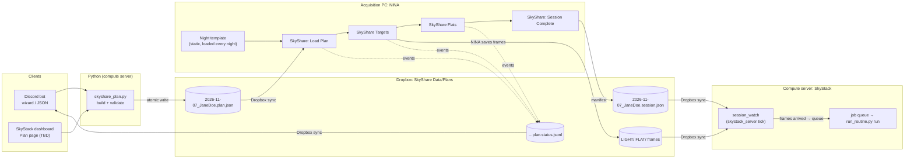
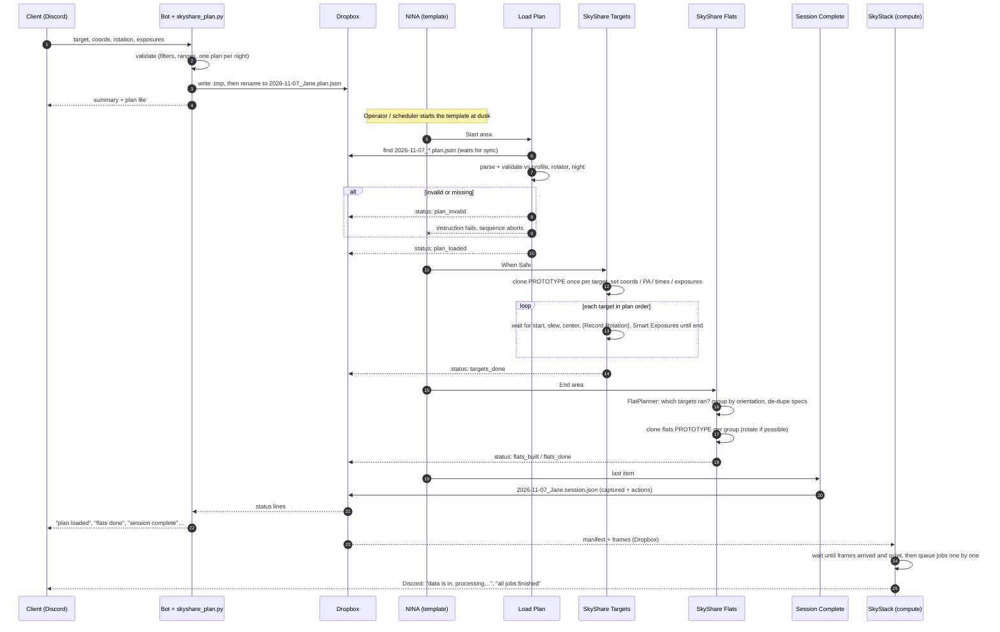
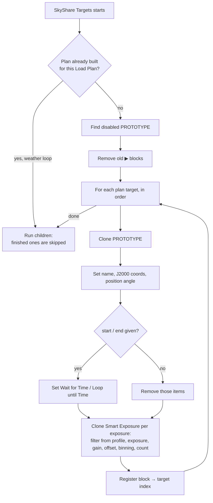
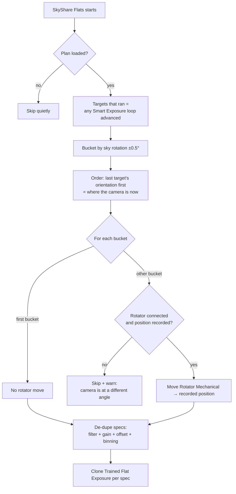
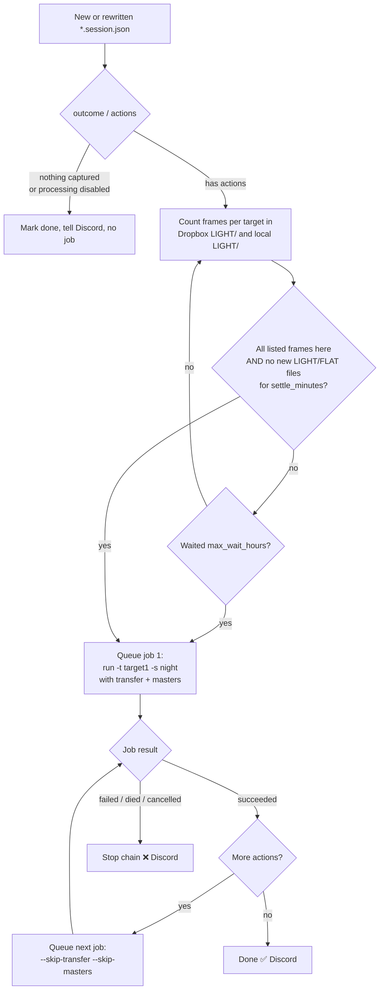

# SkyShare Planner

**SkyShare Planner** builds the night's NINA sequence from a plan file:

1. The Discord bot or the SkyStack dashboard writes a small **plan file** describing one reserved night (targets, order, time windows and exposures) into Dropbox.
2. A NINA plugin reads that plan when the sequence starts and builds the real sequence from NINA's own instruction objects.

This replaces `NINASequenceGenerator.py`, which edited `TemplateSequence.json` as text. Compared with that approach, the plugin:

* handles multiple targets per night, in a fixed order that you control (no scheduler picking targets),
* builds flats after imaging, only for the targets that actually ran, de-duplicated and grouped by camera orientation,
* checks filter names against the live NINA profile and refuses a plan for the wrong night,
* handles `$id`/`$ref` itself, because NINA does the saving and loading, so there is no renumbering,
* reports progress back to Discord,
* hands the night to SkyStack when it ends: a **session manifest** tells the compute server what was captured and what to run, and SkyStack starts the pipeline once the files have arrived ([§6](#6-hand-off-to-skystack)).

> **Status: scaffold.** The Python side and the plugin's logic layer (`SkyShare.Planner.Core`) have tests. The NINA-facing layer has **not been compiled yet**. It was written against the NINA 3.x sequencer API, and calls that need checking against the NINA source are marked `// VERIFY`. See [First build checklist](#first-build-checklist).

---

## 1. Pipeline overview



* **Only the plan file travels.** The NINA template stays the same every night. Everything that varies between nights is in the plan, and everything about how the scope runs is in the template.
* **Dropbox is the transport.** You already sync it, so there are no ports to open and nothing breaks if Tailscale is down. Status comes back the same way, and optionally via a Discord webhook.
* **The night ends with a hand-off.** *Session Complete* writes a manifest. SkyStack waits for the frames it lists, then runs the pipeline jobs it names.
* **Validation happens twice.** Python checks the plan when it's written, so a typo is caught while the user is still in the chat. The plugin checks again at dusk against the real profile and equipment.

---

## 2. What happens during the night



**Weather loops:** if "When Safe" loops after an unsafe interruption, `SkyShare Targets` does **not** rebuild. Finished targets keep their *finished* status, so NINA resumes at the interrupted target.

---

## 3. Template contract

The plugin builds from **prototypes** that you design once, in the NINA UI, inside the template. A prototype decides how a target is run: slew, center, autofocus triggers, guiding, dithering, altitude limits. The plan only supplies the values. A prototype is a normal container named `PROTOTYPE` and set to **Disabled** (right-click > Disable). It never runs itself; it is only cloned.

```text
Night template (saved once; replaces TemplateSequence.json)
│
├─ Start
│   ├─ SkyShare: Load Plan            ← NEW, first instruction (Error behaviour: Abort)
│   └─ STARTUP …                       (unchanged: cool camera, unpark, …)
│
├─ Targets
│   └─ IMAGING INSTRUCTIONS
│       ├─ When Safe
│       │   └─ SkyShare Targets        ← NEW, replaces "TEMPLATE DSO"
│       │       ├─ PROTOTYPE  (Deep Sky Object container, DISABLED)
│       │       │   ├─ Wait for Time           ← optional: plan "start" (Time provider, not Dusk)
│       │       │   ├─ Slew / Center and Rotate
│       │       │   ├─ SkyShare: Record Rotation   ← optional, needed for multi-orientation flats
│       │       │   ├─ triggers: AF after filter change, Center after drift, …
│       │       │   └─ EXPOSURES
│       │       │       ├─ cond: Loop until Time   ← optional: plan "end"
│       │       │       ├─ cond: Altitude (HasDsoParent)
│       │       │       ├─ Smart Exposure          ← exactly one; cloned per plan exposure
│       │       │       └─ Dither                  (anything after stays after)
│       │       ├─ ▶ NGC 7635      (generated at run time)
│       │       └─ ▶ M 31          (generated at run time)
│       └─ When Unsafe …
│
└─ End
    └─ END OF SEQUENCE
        ├─ FLATS
        │   └─ SkyShare Flats          ← NEW, replaces "FLAT INSTRUCTIONS"
        │       ├─ PROTOTYPE  (Sequential, DISABLED)
        │       │   ├─ Move Rotator Mechanical  ← optional; set or removed per group
        │       │   └─ Trained Flat Exposure    ← exactly one; cloned per flat spec
        │       ├─ ▶ Flats @ 35° - M 31       (generated: current orientation first)
        │       └─ ▶ Flats @ 0° - NGC 7635    (generated, only if a rotator exists)
        ├─ END …
        └─ SkyShare: Session Complete  ← NEW, very last item: writes the manifest for SkyStack
```

| Plan field | Written to |
|---|---|
| `name`, `ra`, `dec` | DSO container `Target.TargetName`, `Target.InputCoordinates` (J2000). Center and Altitude items with *HasDsoParent* inherit them. |
| `rotation` | `Target.PositionAngle`, used by *Center and Rotate* |
| `start` / `end` | `Wait for Time` / `Loop until Time` in the prototype. Removed if `null`. |
| `exposures[]` | one Smart Exposure per entry: `SwitchFilter.Filter`, `TakeExposure.ExposureTime / Gain / Offset / Binning`, `LoopCondition.Iterations` |
| `flats.count` | `LoopCondition.Iterations` inside each Trained Flat Exposure |

Generated blocks start with `▶ `. Every run deletes and rebuilds them, so the saved template never accumulates old targets.

---

## 4. How targets are built



---

## 5. How flats are decided

Flats are built **after** imaging, so the plugin knows what actually happened during the night.



* **Flat spec = filter + gain + offset + binning.** Two targets at the same orientation that both shoot H at gain 100 share one H flat set.
* **Trained Flat Exposure** looks up panel brightness and exposure from NINA's trained-flat table, so `FLAT_LIBRARY` moves from Python into NINA (Flat Wizard / Flat Panel tab).
* **Without a rotator,** a multi-orientation night can only get flats for the final orientation. The bot warns about this when the plan is created, and the plugin logs it again at dusk.
* **Why record the rotator position:** the plan stores the sky position angle, but the rotator's *mechanical* angle for that PA depends on its sync. `SkyShare: Record Rotation` measures it right after *Center and Rotate*, so the flats can return to exactly the same orientation.

---

## 6. Hand-off to SkyStack

When the night ends, **SkyShare: Session Complete** writes `<night>_<client>.session.json` next to the plan. It's an atomic write, like the plan. The manifest carries two things:

* **What was captured:** frames per target and filter (counted from the Smart Exposure loops), plus the flat sets taken. SkyStack uses these counts to know when Dropbox has delivered everything.
* **What to do with it:** an explicit `actions` list. v1 has one action type, `skystack_run`, which means `run_routine.py run -t <target> -s <night> [--triage …] [--export] [--postprocess]`. The options come from the plan's `processing` block, so the client's reservation decides them. There's one action per target that got frames.

```json
{
  "schema_version": 1, "kind": "skyshare_session",
  "night": "2026-11-07", "client": "Jane Doe", "outcome": "partial",
  "targets": [
    { "name": "NGC 7635 Jane Doe", "session": "2026-11-07", "ran": true,
      "lights": { "H": 20, "O": 10 }, "lights_total": 30, "planned_total": 30 },
    { "name": "M 31 Jane Doe", "session": "2026-11-07", "ran": true,
      "lights": { "L": 41 }, "lights_total": 41, "planned_total": 120 }
  ],
  "flats": { "frames_total": 150, "sets": [ … ], "skipped": [] },
  "actions": [
    { "type": "skystack_run", "target": "NGC 7635 Jane Doe", "sessions": ["2026-11-07"],
      "triage": "send", "postprocess": null, "export": true },
    { "type": "skystack_run", "target": "M 31 Jane Doe", "sessions": ["2026-11-07"],
      "triage": "send", "postprocess": null, "export": true }
  ]
}
```

On the compute server, `skystack/session_watch.py` runs on every `skystack_server.py` tick (15 s):



* **Jobs run one at a time.** A job is queued only after the previous one succeeded, because the first job runs transfer and masters and later ones rely on that. They use SkyStack's normal job queue, so they appear in the dashboard, keep to the one-PixInsight-at-a-time rule, and need **Approve** if `session_watch.needs_approval: true`.
* **The flats wait is covered too.** "No new LIGHT/FLAT files for `settle_minutes`" means flats that sync after the lights are in place before `masters` runs.
* **Missing frames:** after `max_wait_hours` it runs with what has arrived and lists what was short.
* **No manifest:** if a plan's night is over (by `overdue_hour` the next day) and there's no manifest, it reports once. That usually means the sequence aborted before *Session Complete*. Nothing runs automatically; start it from the dashboard.
* **Re-runs:** if NINA rewrites the manifest (a new `completed_utc`), the session is handled again. Otherwise restarts never queue anything twice. State is kept in `pipeline_jobs/skyshare/sessions.json`.
* **Unknown action types** are skipped and reported, so newer plugins don't break older SkyStack versions.
* Check without changing anything: `python -m skystack.session_watch --dry-run`.

**Folder names must line up.** SkyStack looks for `LIGHT/<target>/<night>/`, so NINA's image file pattern has to produce that:
* `$$TARGETNAME$$` gives the target folder. The plugin sets it to the plan's target name, and the bot appends the client name as before (`M 31 Jane Doe`).
* `$$DATEMINUS12$$` gives the session folder. It's the date the night started, the same as the plan's `night`.
* For example: `$$IMAGETYPE$$\$$TARGETNAME$$\$$DATEMINUS12$$\$$IMAGETYPE$$\$$FILTER$$\…`. Keep the rest of your current pattern.

SkyStack config (`config.yaml`):

```yaml
session_watch:
  enabled: true
  plans_dir: 'D:\Dropbox\SkyShare Data\Plans'
  settle_minutes: 10
  max_wait_hours: 12
  needs_approval: false
  overdue_hour: 14
```

---

## 7. Plan file (schema v1)

File name: `YYYY-MM-DD_<Client>.plan.json`. The date is the **evening the night starts**, so a session running at 02:00 on the 8th uses the file dated the 7th. Only one plan per night is allowed; the writer and the plugin both refuse more than one.

```json
{
  "schema_version": 1,
  "night": "2026-11-07",
  "client": "Jane Doe",
  "targets": [
    { "name": "NGC 7635", "ra": "23:20:48.3", "dec": "+61:12:06", "rotation": 0,
      "start": null, "end": "23:30",
      "exposures": [ { "filter": "H", "exposure": 300, "count": 20, "gain": 100 } ] },
    { "name": "M 31", "ra": "00:42:44.3", "dec": "+41:16:09", "rotation": 35,
      "start": "23:30", "end": null,
      "exposures": [ { "filter": "L", "exposure": 120, "count": 60, "gain": 0 } ] }
  ],
  "flats": { "enabled": true, "count": 30 },
  "processing": { "enabled": true, "triage": "send", "postprocess": null, "export": true }
}
```

`processing` is passed through to the session manifest as SkyStack actions (§6). `null` means use SkyStack's config default. Set `"enabled": false` for capture-only nights. Target names are also SkyStack folder names, so they must be unique within a plan.

The full definition is in [`schema/plan.schema.json`](schema/plan.schema.json), and there's a complete example in [`examples/`](examples/). `gain` and `offset` default to `-1`, meaning the camera default. `start` and `end` are local 24-hour times.

---

## 8. Repository layout

```text
SkySharePlanner/
├─ README.md
├─ schema/plan.schema.json            plan contract shared by Python and C#
├─ schema/session.schema.json         session manifest contract (NINA → SkyStack)
├─ examples/2026-11-07_JaneDoe.plan.json
├─ python/
│  ├─ skyshare_plan.py                model, validate, plan_from_wizard, atomic write_plan, summary
│  ├─ bot_integration.py              publish_from_bot() + StatusTailer for skysharebot.py
│  └─ test_skyshare_plan.py           pytest (13 tests)
└─ nina-plugin/
   ├─ SkyShare.Planner.sln
   ├─ SkyShare.Planner.Core/          pure logic, no NINA refs, builds on any OS
   │  ├─ PlanModel.cs                 JSON model
   │  ├─ PlanParser.cs                parse + PlanValidator
   │  ├─ PlanLocator.cs               night rollover, find tonight's file
   │  ├─ FlatPlanner.cs               which flats, grouped how
   │  ├─ SessionManifest.cs           end-of-night manifest + actions
   │  └─ Sexagesimal.cs
   ├─ SkyShare.Planner.Tests/         NUnit tests for Core
   └─ SkyShare.Planner/               the NINA plugin (WPF, Windows)
      ├─ SkySharePlannerPlugin.cs     manifest
      ├─ Properties/AssemblyInfo.cs   plugin metadata
      ├─ Runtime/PlanStore.cs         shared state for the night
      ├─ Runtime/SequenceTree.cs      clone / find / UI-thread helpers
      ├─ Runtime/StatusReporter.cs    status.jsonl + optional webhook
      ├─ Sequencer/LoadPlan.cs        instruction
      ├─ Sequencer/RecordRotation.cs  instruction
      ├─ Sequencer/SkyShareTargets.cs container
      ├─ Sequencer/TargetBuilder.cs
      ├─ Sequencer/SkyShareFlats.cs   container
      ├─ Sequencer/FlatsBuilder.cs
      ├─ Sequencer/SessionComplete.cs instruction (writes the manifest)
      └─ Resources/DataTemplates.xaml sequencer UI
skystack-integration/                 drop-in for the SkyStack repo
├─ skystack/session_watch.py          watcher (new)
├─ tests/test_session_watch.py        11 tests
└─ skystack-session-watch.patch       full patch: the two files + skystack_server.py hook + config.yaml section
```

The plugin compiles the Core files in directly, so only one DLL needs deploying, and the tested logic is the same code that runs in NINA.

---

## 9. Setup

### 9.1 Build and install the plugin (acquisition PC)

1. Install the .NET SDK that matches your NINA (8 for NINA 3.2, 10 for 3.3 nightlies) and Visual Studio with *.NET desktop development*.
2. Open `nina-plugin/SkyShare.Planner.sln` and build **Debug**. The post-build step copies the DLL to `%LOCALAPPDATA%\NINA\Plugins\3.0.0\SkyShare Planner\`.
3. Restart NINA. A **SkyShare** category appears in the sequencer's instruction list.
4. To run the logic tests (any OS): `dotnet test nina-plugin/SkyShare.Planner.Tests`.

### 9.2 Train flats in NINA (once per filter and gain)

In the Flat Wizard, train every filter + gain + binning combination clients can request (L/R/G/B at gain 0, H/O/S at gain 100). This replaces `FLAT_LIBRARY`. Trained Flat Exposure won't run for a combination that hasn't been trained.

### 9.3 Convert the template

1. Open your current `TemplateSequence.json` in NINA.
2. In **Start**, add **SkyShare: Load Plan** as the first item. Set the plans folder to `…\Dropbox\SkyShare Data\Plans` and the error behaviour to **Abort**.
3. In **When Safe**, add **SkyShare Targets**. Drag your existing `TEMPLATE DSO` into it, rename it `PROTOTYPE` and **Disable** it. Check that it contains:
   * an `EXPOSURES` container with **exactly one** Smart Exposure (its filter and values don't matter),
   * optionally *Wait for Time* (Time provider) and a *Loop until Time* condition on `EXPOSURES`,
   * optionally *SkyShare: Record Rotation* after *Center and Rotate*.
4. In **FLATS**, add **SkyShare Flats**. Inside it, create a Sequential container named `PROTOTYPE`, **Disable** it, and add **one** Trained Flat Exposure (plus *Move Rotator Mechanical* if you have a rotator). Delete the old `FLAT INSTRUCTIONS` container.
5. Add **SkyShare: Session Complete** as the **last** item of the End area.
6. Check NINA's image file pattern (Options > Imaging). It must give `LIGHT/<target>/<$$DATEMINUS12$$>/…`, as described in §6.
7. Save it as the night template. The same file is loaded every night.

### 9.4 Make the Dropbox folder reliable

* Mark `SkyShare Data\Plans` as **Available offline** on the acquisition PC. Otherwise Dropbox can leave online-only placeholders that NINA can't read.
* `write_plan()` writes a hidden `.tmp` file and renames it, so NINA never reads a half-synced file. *Load Plan* also waits up to *Wait for sync* minutes (default 10) for the file to appear.

### 9.5 Wire up the Discord bot

Add `plans_directory` to `config.yaml` under `discord:`, then in `skysharebot.py` replace both `updateSequence(...)` calls:

```python
from bot_integration import publish_from_bot, StatusTailer
from skyshare_plan import PlanError

try:
    path, text = await asyncio.to_thread(publish_from_bot, seq, PLANS_DIR)
    await channel.send(f"Plan saved for NINA:\n{text}", file=discord.File(path))
except PlanError as e:
    await channel.send("Plan rejected:\n- " + "\n- ".join(e.problems))
```

Your existing wizard dict (`name, ra, dec, rot, exposures, date, user`) works unchanged. `plan_from_wizard` converts `DD-MM-YYYY` dates and applies your narrowband-gain rule. For multi-target nights, pass `{"date", "user", "targets": [ {...}, {...} ]}`, where each entry has the same keys plus optional `start`/`end`.

To post the night's progress, run `StatusTailer(PLANS_DIR).poll()` every 30 s from a `tasks.loop`. There's an example in the `bot_integration.py` docstring.

Optional instant alerts: set the environment variable `SKYSHARE_DISCORD_WEBHOOK` on the acquisition PC. It's kept out of the template and out of Dropbox deliberately.

> ⚠️ `config.yaml` currently contains the bot token in plain text. Reset it in the Discord Developer Portal, then load it from an environment variable or an untracked file before this goes anywhere near the SkyStack repo.

### 9.6 SkyStack (compute server)

From the SkyStack repo root, run `git apply path/to/skystack-session-watch.patch`. Alternatively, copy `skystack-integration/skystack/session_watch.py` and the test into place and make the two small edits shown in the patch: one line in `skystack_server.tick`, and the config section. Then set `session_watch.enabled: true` and restart `skystack_server.py`. Discord messages use the existing `SKYSTACK_DISCORD_WEBHOOK`.

### 9.7 SkyStack dashboard

Build the planned "Plan" page with the same module: a form, then `plan_from_wizard(...)` (or build `Plan(...)` directly), then `write_plan(plan, PLANS_DIR)`. If owner approval is required, write the plan into an approval queue first and call `write_plan` only once it's approved. The dashboard can tail the same `*.status.jsonl` files.

---

## 10. Failure behaviour

| Situation | What happens |
|---|---|
| No plan for tonight after the sync wait | *Load Plan* fails, the sequence aborts, and `plan_missing` is reported |
| Two plans for the same night | Refused by `write_plan`, and *Load Plan* fails if one arrives anyway |
| Plan dated for another night | *Load Plan* fails (protects against a stale file) |
| Filter not in the NINA profile | Rejected by the bot (if `KNOWN_FILTERS` is up to date), and *Load Plan* fails |
| Different rotations, no rotator | Warned at creation and at dusk; flats only for the final orientation |
| Target never got a frame (clouds, altitude) | No flats taken for it |
| Weather interruption mid-target | "When Safe" loops and resumes at the interrupted target, with no rebuild |
| Trained flat missing for a spec | NINA's Trained Flat Exposure errors on that item; the others continue |
| Status file / webhook fails | Logged only; imaging is never affected |
| Sequence aborted before Session Complete | No manifest; SkyStack reports the plan as overdue once, and nothing runs automatically |
| Frames still syncing | SkyStack waits for every listed frame, and for no new files for `settle_minutes` |
| Frames never arrive | After `max_wait_hours` SkyStack runs with what arrived and says what was short |
| A pipeline job fails | The chain stops and the remaining targets aren't started; Discord gets the job id |
| Manifest written again (re-run) | Handled again as a new session |

---

## First build checklist

The Core layer is tested. The NINA layer still needs one pass in Visual Studio against the real `NINA.Plugin` package. Search for `VERIFY`:

* `ExportMetadata("Icon", …)` keys: use any SVG key from NINA's resources.
* `SequenceEntityStatus.DISABLED`: the status NINA 3 uses for "Disable".
* `SequenceEntityFailedException` namespace (`NINA.Core.Model`).
* `ISequenceContainer.Insert(int, item)`: if it's missing, use `Add()` and accept that items go at the end.
* `WaitForTime` / `TimeCondition`: the `Hours`/`Minutes` setters, and the prototype must use the plain *Time* provider.
* `RotatorInfo.MechanicalPosition`, `MoveRotatorMechanical.MechanicalPosition`.
* Trained Flat Exposure: confirm it reads the trained brightness and exposure at run time, from the gain and binning set on its inner TakeExposure.
* `File.Move(tmp, final, overwrite: true)` in Session Complete: fine on NTFS. If Dropbox briefly locks the target, add a retry.
* Container views: if *SkyShare Targets/Flats* render blank, add a DataTemplate (see the comment in `DataTemplates.xaml`).

**Target Scheduler** and **Advanced API** are open-source NINA plugins and good references for each of these. Both build and modify sequencer objects at run time.

Suggested first test: use NINA's simulator profile, a plan with two short targets (10 s exposures) whose `end` times are a few minutes apart, and the flat panel simulator.

---

## Roadmap

* **Calibration-only nights:** add `"kind": "calibration"` in schema v2 (darks, or flats for a given orientation, with no targets), plus a `SkyShare Darks` container.
* **Mosaics:** add `"panels"` to a target and expand them into one generated block per panel (port the Framing Assistant maths).
* **Dashboard Plan page** with an FoV preview (reuse the bot's `generate_fov_image`) and an altitude and time-window check before submitting.
* **Live state:** if you later want "what's running now" in the dashboard, read it from the Advanced API (`/v2/api/sequence/json`) over Tailscale, alongside the status file.
